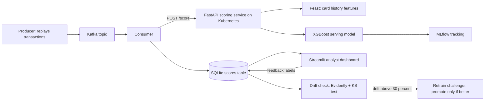

# Real-Time Financial Fraud Detection Platform (AIML-01)

A system that reads a live stream of card transactions, scores each one for fraud risk in milliseconds, and shows the riskiest cases to a human analyst who can confirm or reject them.

**Dataset:** IEEE-CIS Fraud Detection (Kaggle), 590,540 transactions, about 3.5% fraud.

## Architecture



## Tech stack

Kafka, XGBoost, PyTorch Geometric, Feast, MLflow, FastAPI, Kubernetes (Minikube), Evidently AI, Streamlit, Docker.

## What I built, step by step

1. **EDA:** found heavy class imbalance (about 3.5% fraud), so accuracy is a useless metric. I use PR-AUC.
2. **Features:** per-card history features (transactions before, seconds since last, amount versus the card's average, device/address/email changed). Every feature uses only past transactions, to avoid data leakage.
3. **Feast:** features are stored once and used for both training and live scoring.
4. **XGBoost:** class weights for imbalance, time-based train/validation/test split, early stopping, all runs tracked in MLflow.
5. **Graph neural network:** GraphSAGE on a graph where each transaction links to the previous one with the same card, device, or email+address.
6. **Kafka:** a producer replays transactions, a consumer sends each one to the API and stores the score.
7. **Drift monitoring:** compares training data with the newest data and triggers retraining if more than 30% of features drift.
8. **Dashboard:** analysts review alerts, mark them Confirm fraud / False alarm / Escalate, and download the feedback labels.
9. **Kubernetes:** the scoring API runs as a container with a readiness probe and memory limits.

## Results (all measured)

| Model | Test PR-AUC | Test ROC-AUC |
|---|---|---|
| Random guessing | 0.034 | 0.50 |
| XGBoost baseline, 12 features | 0.119 | 0.754 |
| XGBoost, 59 features + early stopping | **0.473** | **0.895** |
| GNN alone | 0.291 | not measured |
| GNN + XGBoost blend | 0.473 (blend weight chose 0) | 0.895 |

**Live pipeline test** (2,000 transactions through Kafka, then the API on Kubernetes):

| Metric | Value |
|---|---|
| Transactions / real frauds | 2000 / 91 |
| Latency average / 95th percentile | 6.3 ms / 8.2 ms |
| PR-AUC / ROC-AUC | 0.352 / 0.805 (random PR-AUC 0.046) |

| Alert threshold | Alerts | Precision | Recall |
|---|---|---|---|
| 0.3 | 315 | 0.17 | 0.60 |
| 0.5 | 157 | 0.31 | 0.53 |
| 0.7 | 77 | 0.38 | 0.32 |

**Drift check:** 5 of 45 features drifted (11%), below the 30% trigger, so no retraining was needed.

Screenshots are in `docs/screenshots/`.

## Limitations and honest notes

- The live service uses a smaller **serving model** (features available at request time), so its PR-AUC is lower than the 59-feature model.
- The GNN did **not** improve the final model. The blend weight was chosen on validation data and came out as 0, so XGBoost stays in production. GNN training was still improving at 30 epochs, so a longer run might help.
- Only the **API** runs on Kubernetes. The consumer and dashboard run locally.
- The retraining path exists but was never triggered in a real run, because drift stayed below the threshold.
- Analyst feedback labels are collected but are not yet used for retraining.
- The fraud labels come from the Kaggle dataset, so the analyst demo is a demonstration, not real casework.
- This project is for learning only and is not for real financial decisions.

## How to run it

```
python -m venv venv
venv\Scripts\activate
pip install pandas numpy scikit-learn xgboost feast mlflow fastapi uvicorn requests kafka-python streamlit evidently scipy torch torch_geometric pyarrow
kaggle competitions download -c ieee-fraud-detection -p data
```

Then run the notebooks in order: `01_EDA`, `02_features`, `03_model`, `05_graph`, `06_serving`. After that:

```
docker compose -f docker\docker-compose.yml up -d
cd feature_repo
feast apply
feast materialize 2017-12-01T00:00:00 <split time>
cd ..
uvicorn src.api:app --port 8000
python src\producer.py 100 2000
python src\consumer.py
streamlit run src\dashboard.py
python src\check_drift.py
```

Kubernetes: build the image from `docker/Dockerfile.api`, then `kubectl apply -f k8s/api.yaml`.
